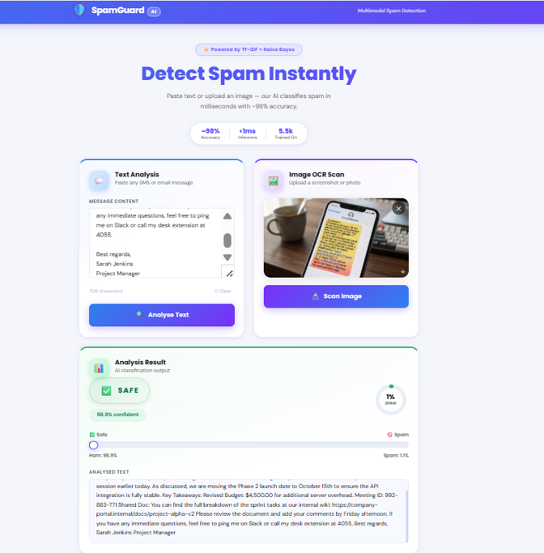
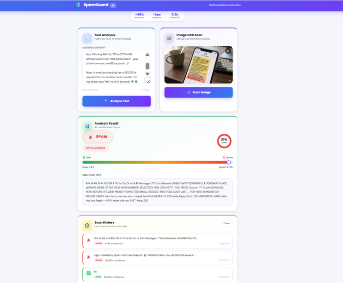
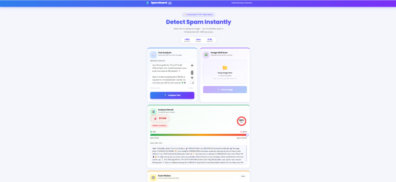
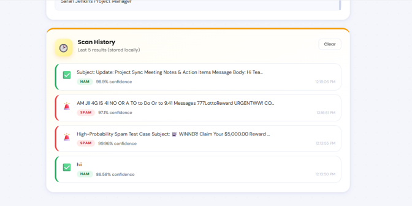

# 🛡️ SpamGuard AI — Multimodal Spam Detection System

[](https://www.python.org/)
[](https://flask.palletsprojects.com/)
[](https://scikit-learn.org/)
[](https://github.com/JaidedAI/EasyOCR)
[](LICENSE)

A production-ready, SaaS-style multimodal spam classification dashboard and REST API built with **Flask + Scikit-learn + EasyOCR**. Detects spam across both plain-text messages and uploaded screenshot/photo images using deep-learning optical character recognition (OCR) coupled with TF-IDF n-gram feature extraction and Multinomial Naive Bayes classification.

---

## 📸 Screenshots & Dashboard Preview

| **Dashboard Overview & Multimodal Inputs** | **Detection Verdict & Confidence Gauge** |
|:---:|:---:|
| <br><sub>*Full dashboard with dual text analysis and drag-and-drop OCR image scanning.*</sub> | <br><sub>*Real-time verdict banner, circular gauge, and probability meter.*</sub> |

| **Hero Header & Performance Metrics** | **Scan History Drawer** |
|:---:|:---:|
| <br><sub>*Hero stats strip highlighting ~98.8% accuracy and sub-millisecond inference.*</sub> | <br><sub>*Recent scan history with verdict badges, confidence, and timestamps.*</sub> |

---

## 📋 Table of Contents

1. [Project Overview & Objectives](#-project-overview--objectives)
2. [Features & Capabilities](#-features--capabilities)
3. [Technology Stack](#-technology-stack)
4. [System Architecture & Prediction Flow](#-system-architecture--prediction-flow)
5. [Repository Structure](#-repository-structure)
6. [Installation & Windows Quick Start](#-installation--windows-quick-start)
7. [Model Training & Dataset](#-model-training--dataset)
8. [Running the Application](#-running-the-application)
9. [User Guide (Text & Image OCR)](#-user-guide)
10. [REST API Documentation](#-rest-api-documentation)
11. [Evaluation Metrics & Performance](#-evaluation-metrics--performance)
12. [Testing Suite](#-testing-suite)
13. [Limitations & Future Improvements](#-limitations--future-improvements)
14. [Troubleshooting](#-troubleshooting)
15. [License](#-license)

---

## 🎯 Project Overview & Objectives

Spam and phishing attacks represent persistent cyber threats, with SMS phishing (*smishing*) and screenshot-based lures increasingly evading traditional string matching. 

**SpamGuard AI** provides an end-to-end, machine-learning-driven defense system designed to:
- Ingest both raw text and screenshots/images.
- Apply domain-specific text preprocessing that extracts financial and urgency tokens (`$`, `₹`, `%`, `!`, URLs, phone numbers).
- Classify messages with high precision to keep legitimate communications safe while filtering malicious messages.
- Provide sub-second inference and a modern, responsive glassmorphism interface.

---

## ✨ Features & Capabilities

- **Dual-Modality Detection**: Seamlessly processes raw text (SMS/email) and raster image screenshots (PNG, JPG, WEBP, TIFF, BMP, GIF).
- **Deep-Learning OCR with Fallback**: Uses EasyOCR with a cached singleton reader to extract text from images with low latency, supported by an optional Tesseract fallback.
- **Robust Preprocessing Pipeline**: Converts URLs, phone numbers, numeric amounts, and high-signal spam markers (`$`, `₹`, `%`, `!`) into dedicated tokens.
- **Visual Confidence Meter & Gauge**: Displays an SVG circular gauge alongside an animated progress bar indicating exact spam vs. ham probability.
- **Client-Side Scan History**: Automatically records the last 5 scans in browser `localStorage`, with one-click clearing and XSS-safe rendering.
- **Dark Glassmorphism Interface**: Responsive, accessible interface featuring Poppins typography, ARIA attributes, and toast notifications.
- **Standalone REST API**: Modular JSON API endpoints for integration into automation pipelines and external services.

---

## 💻 Technology Stack

| Layer | Component | Version | Purpose |
|---|---|---|---|
| **Web Server** | [Flask](https://flask.palletsprojects.com/) | `>=3.0.0` | WSGI routing, REST API endpoints, template serving |
| **WSGI Utilities** | [Werkzeug](https://palletsprojects.com/p/werkzeug/) | `>=3.0.0` | Request handling and 10 MB payload enforcement |
| **ML Classifier** | [Scikit-learn](https://scikit-learn.org/) | `>=1.4.0` | TF-IDF Vectorizer and Multinomial Naive Bayes |
| **Persistence** | [Joblib](https://joblib.readthedocs.io/) | `>=1.3.0` | Serialization of trained model and vectorizer pipelines |
| **Data Processing** | [pandas](https://pandas.pydata.org/) / [NumPy](https://numpy.org/) | `>=2.1.0` / `>=1.26.0` | Tabular data manipulation and array operations |
| **OCR Engine** | [EasyOCR](https://github.com/JaidedAI/EasyOCR) | `>=1.7.0` | Deep-learning optical character recognition |
| **Image Processing** | [Pillow (PIL)](https://python-pillow.org/) | `>=10.0.0` | In-memory image decoding and RGB normalization |
| **Frontend UI** | HTML5 / CSS3 / JavaScript | Modern ES6+ | Glassmorphism dashboard, SVG gauges, localStorage |

---

## 🧠 System Architecture & Prediction Flow

```
                      ┌────────────────────────────┐
                      │    Client (Web / API)      │
                      └───────┬────────────┬───────┘
                              │            │
                    Raw Text  │            │ Image Upload
                              ▼            ▼
                   ┌──────────────┐   ┌───────────────────────────┐
                   │ POST /       │   │ POST /predict-image       │
                   │ predict-text │   │ (EasyOCR Singleton Cache) │
                   └──────┬───────┘   └─────────────┬─────────────┘
                          │                         │ Extracted Text
                          └───────────┬─────────────┘
                                      ▼
                        ┌───────────────────────────┐
                        │ clean_text() Preprocessing│
                        │ • URLs   → 'url'          │
                        │ • $      → 'dollar'       │
                        │ • ₹      → 'rupee'        │
                        │ • %      → 'percent'      │
                        │ • !      → 'exclamation'  │
                        │ • Digits → 'phone'/'number'│
                        └─────────────┬─────────────┘
                                      ▼
                        ┌───────────────────────────┐
                        │ TfidfVectorizer           │
                        │ (Unigrams + Bigrams, 10k) │
                        └─────────────┬─────────────┘
                                      ▼
                        ┌───────────────────────────┐
                        │ MultinomialNB Classifier  │
                        │ (alpha=0.1 Laplace smooth)│
                        └─────────────┬─────────────┘
                                      ▼
                        ┌───────────────────────────┐
                        │ predict_proba() Output    │
                        │ { label, confidence,      │
                        │   spam_prob, ham_prob }   │
                        └───────────────────────────┘
```

---

## 📁 Repository Structure

```
SpamGuard-AI/
├── app.py                     # Flask application and REST API endpoints
├── preprocess.py              # Shared text normalization and tokenization pipeline
├── train_model.py             # Dataset downloader, trainer, and evaluator
├── requirements.txt           # Python dependencies
├── run.bat                    # One-click portable Windows runner
├── .gitignore                 # Git ignore rules for virtualenvs, caches, and logs
├── README.md                  # Comprehensive project documentation
├── model/                     # Serialized machine learning artifacts
│   ├── spam_model.joblib      # Trained MultinomialNB classifier
│   └── vectorizer.joblib      # Fitted TfidfVectorizer pipeline
├── templates/
│   └── index.html             # Dashboard UI template
├── static/
│   └── css/
│       └── style.css          # Glassmorphism dark styling & animations
├── Screenshot/                # UI demonstration screenshots
│   ├── Picture1.png           # Hero header & stats strip
│   ├── Picture2.png           # Text analysis & classification result
│   ├── Picture3.png           # Complete multimodal dashboard view
│   └── Picture4.png           # LocalStorage scan history drawer
└── tests/
    └── test_spamguard.py      # Automated unit and integration test suite
```

---

## 🚀 Installation & Windows Quick Start

### Prerequisites
- Python 3.9 or higher (tested on Python 3.9, 3.10, 3.11, 3.12, and 3.13).
- Git installed on your system.

### 1. Clone the Repository
```bash
git clone https://github.com/AdarshKasaudhan1/SpamGuard-AI.git
cd SpamGuard-AI
```

### 2. Create and Activate Virtual Environment
**Windows (PowerShell or Command Prompt):**
```powershell
python -m venv venv
venv\Scripts\activate
```

**macOS / Linux:**
```bash
python3 -m venv venv
source venv/bin/activate
```

### 3. Install Dependencies
```bash
pip install --upgrade pip
pip install -r requirements.txt
```

> **Note on EasyOCR weights:** EasyOCR downloads its pre-trained OCR recognition models (~100 MB) automatically on the first image scan, cached locally under `~/.EasyOCR/`.

---

## 🏋️ Model Training & Dataset

The model uses the **UCI Machine Learning Repository SMS Spam Collection** (5,572 labeled messages: 747 spam, 4,825 ham).

To train the model and generate fresh artifacts:
```bash
python train_model.py
```

### Training Pipeline Details
1. **Automated Download**: Fetches `smsspamcollection.zip` from UCI and extracts `SMSSpamCollection`.
2. **Preprocessing**: Cleans and maps URLs, phone numbers, and currency symbols via `preprocess.clean_text()`.
3. **Stratified Split**: 80% training (4,457 messages), 20% testing (1,115 messages) with preserved class distributions.
4. **Feature Extraction**: `TfidfVectorizer` with `ngram_range=(1, 2)`, `sublinear_tf=True`, and 10,000 maximum features.
5. **Classification**: `MultinomialNB(alpha=0.1)` with Laplace smoothing.
6. **Artifact Persistence**: Serializes artifacts into `model/spam_model.joblib` and `model/vectorizer.joblib`.

---

## 🖥️ Running the Application

### Option A — Portable Windows Batch Script
Double-click `run.bat` or run from PowerShell:
```cmd
run.bat
```

### Option B — Direct Python Launch
```bash
python app.py
```

Once running, navigate to **`http://localhost:5000`** in any web browser.

---

## 📖 User Guide

### 1. Text Analysis
1. Paste or type any SMS or email into the **Message Content** box.
2. Observe the live character counter.
3. Click **Analyse Text** (or press Enter).
4. Review the animated verdict badge, circular gauge, and probability breakdown.

### 2. Image OCR Scanning
1. Drag and drop any image into the **Image OCR Scan** card, or click to browse.
2. Confirm the thumbnail preview. (Click **✕** if you wish to remove and choose another).
3. Click **Scan Image**.
4. The system runs deep-learning OCR, extracts visible text, and immediately runs spam classification.

### 3. Scan History
- The 5 most recent scans are stored locally in your browser session.
- Click **Clear** in the Scan History header to reset the history drawer.

---

## 🔌 REST API Documentation

### 1. Plain Text Prediction

**`POST /predict-text`**

**Request Headers:**
```http
Content-Type: application/json
```

**Request Body:**
```json
{
  "text": "Congratulations! You have won a $1,000 Walmart gift card. Click http://bit.ly/claim now!"
}
```

**Response (`200 OK`):**
```json
{
  "confidence": 99.42,
  "extracted_text": "Congratulations! You have won a $1,000 Walmart gift card. Click http://bit.ly/claim now!",
  "ham_prob": 0.58,
  "label": "spam",
  "spam_prob": 99.42
}
```

---

### 2. Image OCR Prediction

**`POST /predict-image`**

**Request Headers:**
```http
Content-Type: multipart/form-data
```

**Form Fields:**
- `image`: Binary image file (`.png`, `.jpg`, `.jpeg`, `.webp`, `.bmp`, `.tiff`, `.gif`).

**Response (`200 OK`):**
```json
{
  "confidence": 98.65,
  "extracted_text": "URGENT! Your bank account has been locked. Verify at http://secure-login.xyz",
  "ham_prob": 1.35,
  "label": "spam",
  "spam_prob": 98.65
}
```

**Error Responses:**
- `400 Bad Request`: Missing file, empty text, or unselected file.
- `413 Payload Too Large`: Uploaded file exceeds the 10 MB limit.
- `415 Unsupported Media Type`: File extension not allowed.
- `422 Unprocessable Entity`: No readable text found in image.
- `503 Service Unavailable`: Model artifacts not found.

---

## 📊 Evaluation Metrics & Performance

Evaluated on the held-out 20% test partition of the UCI SMS Spam Collection (1,115 messages):

| Metric | Ham (Legitimate) | Spam (Malicious) | Overall / Macro Avg |
|---|:---:|:---:|:---:|
| **Precision** | **0.99** | **0.99** | **0.99** |
| **Recall** | **1.00** | **0.93** | **0.96** |
| **F1-Score** | **0.99** | **0.96** | **0.97** |
| **Support** | 966 messages | 149 messages | 1,115 messages |
| **Accuracy** | — | — | **98.83%** |

### Confusion Matrix
```
                    Predicted Ham    Predicted Spam
Actual Ham (966):        964              2   (False Positive Rate: 0.2%)
Actual Spam (149):        11            138   (Spam Recall: 92.6%)
```

> **Key Strength**: With only **2 false positives out of 966 legitimate messages**, the filter minimizes the risk of marking important messages as spam.

---

## 🧪 Testing Suite

SpamGuard AI includes a test suite covering:
- Text preprocessing & symbol-to-token normalization (`$`, `₹`, `%`, `!`, URLs, phone numbers)
- Model & vectorizer prediction compatibility
- Lazy EasyOCR singleton caching and reuse across requests
- Flask REST API endpoints (`/`, `/predict-text`, `/predict-image`)
- Edge cases (empty submissions, whitespace, oversized payloads, invalid formats)

To run the automated tests:
```bash
python -m unittest tests/test_spamguard.py -v
```

---

## ⚠️ Limitations & Future Improvements

- **Dataset Scope**: The UCI SMS Spam Collection comprises SMS-length communications. Classifying multi-paragraph corporate emails or HTML email structures may benefit from retraining on the Enron or Apache SpamAssassin corpora.
- **Adversarial OCR**: Highly obfuscated text (e.g. extreme noise, CAPTCHAs, or heavily stylized graffiti fonts) can challenge general-purpose OCR models.
- **Future Improvements**:
  - Incorporating a lightweight transformer model (e.g. DistilBERT or DeBERTa) for contextual nuance.
  - Adding batch classification endpoints (`/predict-batch`).
  - Deploying containerized builds with Docker and Gunicorn/Nginx.

---

## 🔧 Troubleshooting

| Issue | Cause | Solution |
|---|---|---|
| `TemplateNotFound: index.html` | Flask cannot find the `templates/` directory | Ensure `templates` is a directory containing `index.html`. |
| `UnicodeEncodeError: 'charmap'` | Windows default CP1252 console output | Reconfigured automatically in `app.py` & `train_model.py`. You can also set `set PYTHONIOENCODING=utf-8`. |
| `easyocr not installed` | Missing package | Run `pip install easyocr Pillow`. |
| Slow first image scan | EasyOCR weight download | Weights download once (~100 MB). Subsequent requests reuse the cached singleton in memory. |
| Port 5000 in use | Another service is using port 5000 | Launch with custom port: `$env:PORT=5050; python app.py` |

---

## 📜 License

Distributed under the **MIT License**. Free for academic, personal, and commercial modification.
